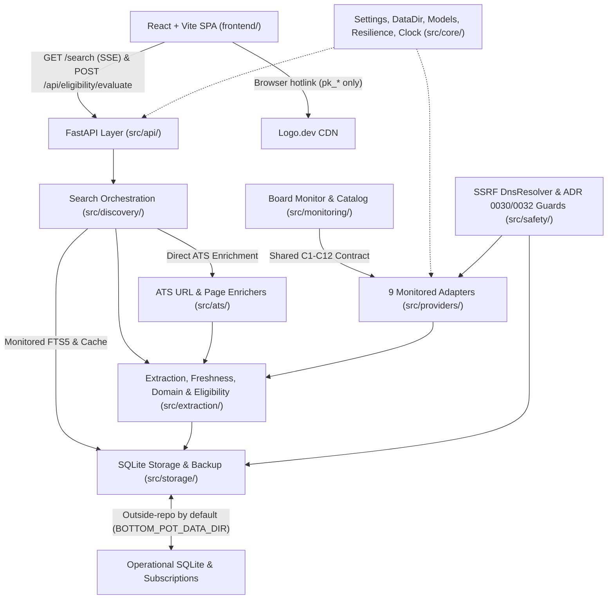

# Bottom Pot

ATS-first job discovery application with transparent applicant-country eligibility, explicit freshness tiers, and direct employer application links. Built with FastAPI (`src/`) and React/Vite (`frontend/`).


## Who It Is For

- **Software engineers, designers, and technical applicants globally** (with Nigeria and wider Africa as priority validation markets) who want direct-to-ATS openings evaluated honestly against where they can work from, rather than aggregator reposts claiming every `"Remote"` job is worldwide.
- **Maintainers running local or curated employer-board monitoring** with strict operational database safety, offline reproducible tests, and fail-closed SSRF checks.

---

## Source & Catalog Status

Bottom Pot maintains strict separation between **search/enrichment sources** and **independently monitored employer-board providers** (`AGENTS.md` §6 **Provider Freeze** applies to new providers and boards):

| Layer | Active Status | Count | Notes |
|---|---|---:|---|
| **Monitored ATS Providers** (`MONITORABLE_PROVIDERS`) | Implemented & contract-verified | **9** | `greenhouse`, `lever`, `ashby`, `workable`, `recruitee`, `smartrecruiters`, `teamtailor`, `personio`, `pinpointhq` ([`docs/providers/inventory.md`](docs/providers/inventory.md)) |
| **Provisional ATS** (`PROVISIONAL_PROVIDERS`) | Search + legacy detail client only | **1** | `bamboohr` (`BambooHRClient`; full board monitoring unsuitable) |
| **Search & Enrichment-Only ATS** (`ATS_PLATFORMS` remainder) | Serper `site:` search + HTML/API enrichment | **8** | `workday`, `jobvite`, `jazzhr`, `icims`, `avature`, `taleo`, `jobadder`, `successfactors` |
| **Regional Job Board Scrapers** (`NIGERIAN_SCRAPERS`) | Active HTML scrapers (`NG`) | **3** | `jobberman`, `myjobmag`, `hotnigerianjobs` |
| **Curated Employer Board Catalog** (`VERIFIED_EMPLOYER_BOARDS`) | **Catalogued (`28`) / Operationally Live (`0`)** | **28** | Verified within existing monitored providers; `operationally_registered: false` until the owner runs [`docs/operations/RUNBOOK.md`](docs/operations/RUNBOOK.md) seeding |

See [`docs/job-source-catalog.md`](docs/job-source-catalog.md) for the complete lifecycle status of every evaluated and rejected source.

---

## Quick Start (~15 Minutes)

Prerequisites: Python `3.11+` (tested cleanly on Python `3.12`), Node.js `20+` (`npm`), and Git.

### Windows (PowerShell)

```powershell
# 1. Clone and enter repo
git clone https://github.com/richmondsogo/bottom-pot.git
cd bottom-pot

# 2. Create Python virtual environment and install backend + test tools
python -m venv .venv
.\.venv\Scripts\Activate.ps1
python -m pip install --upgrade pip
pip install -r requirements.txt -r requirements-dev.txt

# 3. Install frontend dependencies and build the UI
npm --prefix frontend ci
npm --prefix frontend run build

# 4. Copy environment templates (optional keys; keep secrets out of git)
Copy-Item .env.example .env
Copy-Item frontend\.env.example frontend\.env.local

# 5. Run the offline beta smoke check (disposable DB, zero network/credits)
python scripts/smoke.py
```

To run the local web app interactively (outside test/smoke mode), configure `.env` (`SERPER_API_KEY` optional — set `SERPER_MODE=cache_only` for cached/monitored-only browsing) and start via:

```powershell
.\scripts\run_prod.ps1
```

Or run the ASGI server directly after setting `$env:BOTTOM_POT_ALLOW_OPERATIONAL_DB = "1"`:

```powershell
$env:BOTTOM_POT_ALLOW_OPERATIONAL_DB = "1"
python -m uvicorn src.api.main:app --host 127.0.0.1 --port 8000
```

### Linux / macOS (bash)

```bash
# 1. Clone and enter repo
git clone https://github.com/richmondsogo/bottom-pot.git
cd bottom-pot

# 2. Create Python virtual environment and install backend + test tools
python3 -m venv .venv
source .venv/bin/activate
python -m pip install --upgrade pip
pip install -r requirements.txt -r requirements-dev.txt

# 3. Install frontend dependencies and build the UI
npm --prefix frontend ci
npm --prefix frontend run build

# 4. Copy environment templates (optional keys; keep secrets out of git)
cp .env.example .env
cp frontend/.env.example frontend/.env.local

# 5. Run the offline beta smoke check (disposable DB, zero network/credits)
python scripts/smoke.py
```

To launch the local server against the external data directory (`${XDG_DATA_HOME:-~/.local/share}/bottom-pot` on Linux, `~/Library/Application Support/bottom-pot` on macOS):

```bash
BOTTOM_POT_ALLOW_OPERATIONAL_DB=1 python -m uvicorn src.api.main:app --host 127.0.0.1 --port 8000
```

Open `http://127.0.0.1:8000/` for the marketing overview, `http://127.0.0.1:8000/app` for candidate search, `http://127.0.0.1:8000/admin` (requires `ADMIN_PASSWORD`), and `http://127.0.0.1:8000/health` for read-only service metadata.

---

## Testing & Verification

Every unit/integration suite runs **100% offline** with an autouse `socket.getaddrinfo` tripwire (`tests/conftest.py`) rejecting hidden network/DNS calls unless explicitly decorated `@pytest.mark.live`, and forcing isolated disposable SQLite paths (`ADR 0030` / `ADR 0032`):

```powershell
# Static, lint, secret, safety & smoke gates
python -m ruff check src/ tests/ scripts/
python scripts/check_secrets.py
python scripts/check_db_safety.py
python scripts/check_repo_hygiene.py
python scripts/smoke.py

# Full backend offline test suite + C1-C12 provider conformance
python -m pytest -q

# Frontend checks (CSS layers, oxlint, Vitest + shared eligibility vectors, TypeScript + Vite build)
node scripts/lint_css_cascade.js
npm --prefix frontend run lint
npm --prefix frontend run test
npm --prefix frontend run build

# Playwright end-to-end tests (installs Chromium once if absent)
npm install --no-save @playwright/test
npx playwright install chromium
npx playwright test tests/e2e/bottom-pot.spec.js
```

On Windows, `powershell -ExecutionPolicy Bypass -File scripts/verify.ps1` runs the full suite.

---

## Architecture Overview



Detailed module responsibilities and flows live in [`docs/architecture.md`](docs/architecture.md) and [`docs/adr/README.md`](docs/adr/README.md).

---

## Safety, Privacy & Operational Controls

- **Fail-closed SSRF defense (`src/safety/url_safety.py`):** Blocks non-HTTPS URLs, private/loopback/link-local/reserved IPs, DNS rebinding, and unvalidated HTTP redirects (`follow_redirects=False` per hop).
- **Operational DB isolation (`ADR 0030`, `ADR 0032`):** Fresh installs store `cache.sqlite` and `subscriptions.csv` outside git (`BOTTOM_POT_DATA_DIR` / OS app-data dir), existing `<repo>/data/` installs stay protected until migrated, `SafetyError` propagates uncaught (`docs/exception-audit.md`), and WAL/SHM-safe backup/restore rehearsal runs via [`scripts/db_backup.py`](scripts/db_backup.py) ([`docs/operations/RUNBOOK.md`](docs/operations/RUNBOOK.md)).
- **Optional feedback reporting:** Setting `VITE_REPORT_PROBLEM_URL` enables a `"Report a problem with this listing"` link on job detail sheets (`https:` / `mailto:` only), attaching listing metadata with zero user PII.

---

## Logo.dev Attribution & Key Configuration

Bottom Pot resolves company logos through `api -> Logo.dev (fallback=404) -> monogram` (`ADR 0031`):

- Configure **only** a publishable client key (`pk_*`) in gitignored `frontend/.env.local` as `VITE_LOGO_DEV_TOKEN`. Secret `sk_*` keys are rejected in code and blocked by `scripts/check_secrets.py`.
- Restrict your `pk_*` token to allowed domains in the Logo.dev dashboard before hosting.
- Footer links include the required [Logo.dev attribution](https://logo.dev) (`Logos provided by Logo.dev`).

---

## Documentation, License & Third-Party Data

- **Documentation index:** [`docs/README.md`](docs/README.md) (historical execution logs live in [`docs/history/`](docs/history/))
- **Beta usability tasks & untested deploy options:** [`docs/BETA.md`](docs/BETA.md)
- **Contributing & Security:** [`CONTRIBUTING.md`](CONTRIBUTING.md) · [`SECURITY.md`](SECURITY.md)
- **License:** MIT License ([`LICENSE`](LICENSE))
- **Third-Party Data:** Offline test fixtures are public employer/ATS captures governed by [`THIRD_PARTY_DATA.md`](THIRD_PARTY_DATA.md) (including the >500 KB fixture ledger and no-history-rewrite policy).
