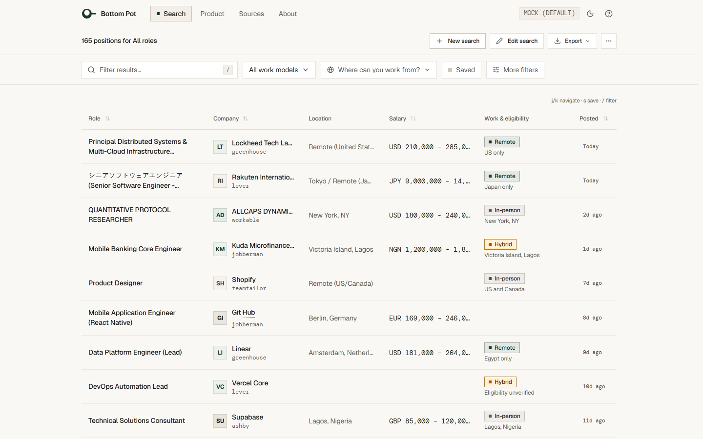
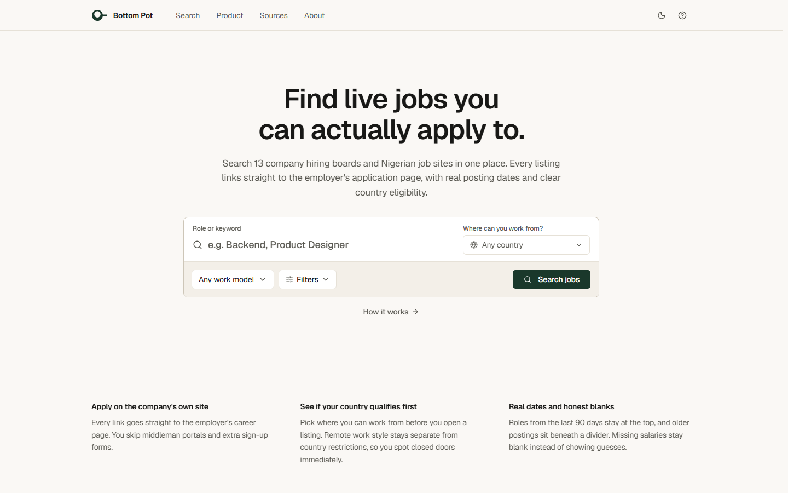
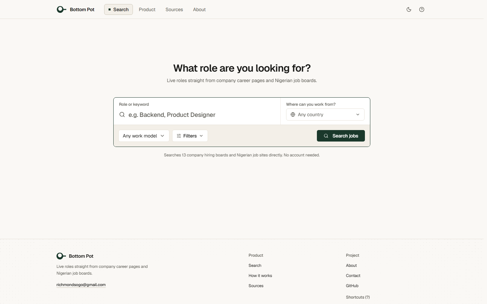
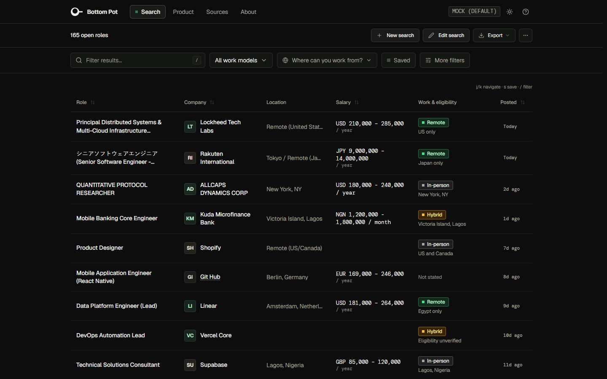
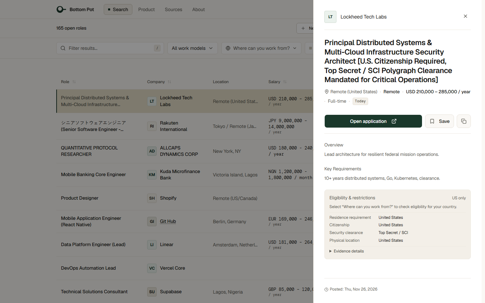
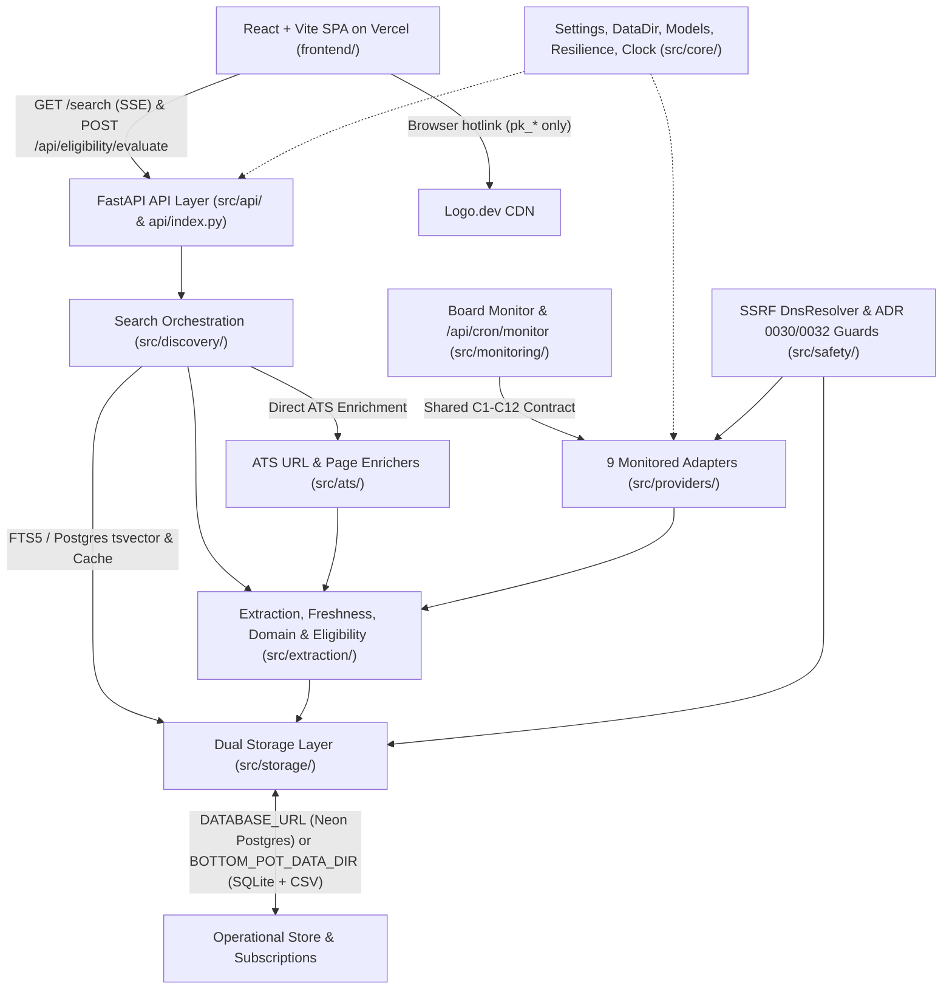

# Bottom Pot

**Jobs straight from the company.**

Bottom Pot searches public company hiring pages and verified Nigerian job boards directly—giving candidates real application links, honest posting dates, un-guessed salary fields, and transparent applicant-country eligibility without sign-up walls or middleman reposts.



<details>
<summary>More product views: Home, Search Form, Dark Mode, and Job Detail Reader</summary>

| View | Preview |
|---|---|
| **Home Overview (`/`)** |  |
| **Calm Search Form (`/app`)** |  |
| **Dark Mode Results (`/app`)** |  |
| **Job Detail Side Reader** |  |

</details>

---

## Why Bottom Pot Exists

- **Direct-to-company application links:** Every opening points straight to the employer's own career page or hiring portal—never through aggregator account walls or recycled tracking links.
- **Work style separated from country rules:** `Remote`, `Hybrid`, and `In-person` classify day-to-day attendance, while `"Where can you work from?"` checks where an applicant can legally apply (`Eligible`, `Restricted`, or `Unverified`) via ISO 3166-1 alpha-2 country evaluation (`POST /api/eligibility/evaluate`).
- **Real dates & honest empty cells:** Fresh roles from the last 90 days appear first; older evergreen listings move beneath a clear `"Older postings"` divider. Missing salaries or ambiguous work policies stay blank instead of being invented.
- **Zero-account candidate workspace:** Fast keyboard triage (`j`/`k`, `s` to shortlist, `/` to filter), private browser shortlist with application stages, and one-click CSV/JSON export.

---

## Source Coverage (`13` Verified Hiring Sources)

Bottom Pot separates continuously monitored company hiring engines, on-demand enterprise portals, and curated Nigerian boards (`AGENTS.md` §6 **Provider Freeze** governs new additions):

| Group | Active Sources | Count | How It Runs |
|---|---:|---:|---|
| **Continuously Monitored Company Engines** (`BOARD_ADAPTERS`) | `greenhouse`, `lever`, `ashby`, `workable`, `recruitee`, `smartrecruiters`, `teamtailor`, `personio`, `pinpointhq` | **9** | Background `BoardMonitor` polling + FTS5 local lookup ([`docs/providers/inventory.md`](docs/providers/inventory.md)) |
| **Enterprise On-Demand Portal** (`ATS_PLATFORMS`) | `workday` | **1** | Phase 2 fallback / explicit live discovery via Serper `site:` & page enrichment |
| **Nigerian Job Boards** (`NIGERIAN_SCRAPERS`) | `jobberman`, `myjobmag`, `hotnigerianjobs` | **3** | Direct HTML/JSON-LD extraction preserving verified logos, corporate mailto/apply domains, and full descriptions |
| **Curated Employer Board Catalog** (`VERIFIED_EMPLOYER_BOARDS`) | Catalogued `28` / Operationally Live `0` | **28** | Pre-verified boards ready for explicit seeding via [`docs/operations/RUNBOOK.md`](docs/operations/RUNBOOK.md) |

See [`docs/job-source-catalog.md`](docs/job-source-catalog.md) for the complete lifecycle status of active and retired sources.

---

## Quick Start (Local Development & Testing)

Prerequisites: **Python 3.11+** (tested on `3.12`), **Node.js 20+** (`npm`), and **Git**.

### Windows (PowerShell)

```powershell
# 1. Clone repository
git clone https://github.com/richmondsogo/bottom-pot.git
cd bottom-pot

# 2. Create Python virtual environment and install dependencies
python -m venv .venv
.\.venv\Scripts\Activate.ps1
python -m pip install --upgrade pip
pip install -r requirements.txt -r requirements-dev.txt

# 3. Install frontend dependencies and build the React + Vite UI
npm --prefix frontend ci
npm --prefix frontend run build

# 4. Copy environment templates (keep real keys out of git)
Copy-Item .env.example .env
Copy-Item frontend\.env.example frontend\.env.local

# 5. Run offline beta smoke check (disposable DB, zero Serper credits)
python scripts/smoke.py
```

Start the production-style local server (outside test/smoke mode; set `SERPER_MODE=cache_only` if running without a `SERPER_API_KEY`):

```powershell
.\scripts\run_prod.ps1
```

### Linux / macOS (bash)

```bash
git clone https://github.com/richmondsogo/bottom-pot.git
cd bottom-pot

python3 -m venv .venv
source .venv/bin/activate
python -m pip install --upgrade pip
pip install -r requirements.txt -r requirements-dev.txt

npm --prefix frontend ci
npm --prefix frontend run build

cp .env.example .env
cp frontend/.env.example frontend/.env.local
python scripts/smoke.py

BOTTOM_POT_ALLOW_OPERATIONAL_DB=1 python -m uvicorn src.api.main:app --host 127.0.0.1 --port 8000
```

Routes:
- `http://127.0.0.1:8000/` — Editorial home overview
- `http://127.0.0.1:8000/app` — Candidate search workspace (`?mock=normal` runs fully offline)
- `http://127.0.0.1:8000/product`, `/sources`, `/about` — Dedicated multi-page guides
- `http://127.0.0.1:8000/admin` — Administrator search & telemetry (requires `ADMIN_PASSWORD`)
- `http://127.0.0.1:8000/health` — Read-only API status & active provider summary

---

## Deploying for Testers (100% Vercel + Neon Postgres)

Bottom Pot deploys cleanly inside **one Vercel Hobby project** backed by serverless **Neon PostgreSQL**:

1. **Unified Vercel Project (root `vercel.json` + `api/index.py` + `frontend/`):**
   - Import the repository in Vercel with **Root Directory** set to `.`. `vercel.json` builds `frontend/` to `frontend/dist`, deploys FastAPI at `api/index.py`, and serves same-origin `/api/*`, `/health`, `/subscribe`, and SSE `/search` alongside all SPA routes.
   - Configure runtime secrets in Vercel: `DATABASE_URL` (Neon Postgres), `CRON_SECRET`, `SERPER_API_KEY`, `SERPER_MODE=fallback`, `ADMIN_PASSWORD`, `ADMIN_SESSION_SECRET`, and `TRUST_PROXY_HEADERS=true`. Leave `VITE_API_BASE_URL` unset so API requests and admin cookies stay same-origin.
2. **Scheduled Board Refreshes (`/api/cron/monitor`):**
   - `vercel.json` runs one daily Hobby-tier cron (`0 6 * * *`) against `/api/cron/monitor?max_boards=10`.
   - For 30-minute board polling on Hobby, add GitHub repository variable `BOTTOM_POT_URL` (`https://your-app.vercel.app`) and secret `CRON_SECRET` for [`.github/workflows/board-monitor.yml`](.github/workflows/board-monitor.yml).
3. **Optional Container Self-Hosting (`Dockerfile`):**
   - When `DATABASE_URL` is unset, Bottom Pot stores WAL SQLite and `subscriptions.csv` in `BOTTOM_POT_DATA_DIR` with an in-process `BoardMonitor` loop (see [`docs/BETA.md`](docs/BETA.md)).

See [`docs/BETA.md`](docs/BETA.md) for the tester observation rubric and pre-flight checklist.

---

## Testing & Verification

All unit and integration tests run **100% offline** with an autouse DNS/socket tripwire (`tests/conftest.py`) and isolated disposable SQLite storage (`ADR 0030` / `ADR 0032`):

```powershell
# Static, lint, secret, DB-safety, hygiene & smoke gates
python -m ruff check src/ tests/ scripts/ api/
python scripts/check_secrets.py
python scripts/check_db_safety.py
python scripts/check_repo_hygiene.py
python scripts/smoke.py

# Backend offline test suite + C1-C12 provider conformance
python -m pytest -q

# Frontend cascade lint, oxlint, Vitest unit tests, TypeScript & Vite build
node scripts/lint_css_cascade.js
npm --prefix frontend run lint
npm --prefix frontend run test
npm --prefix frontend run build

# Full suite including Playwright E2E (Windows PowerShell)
powershell -ExecutionPolicy Bypass -File scripts/verify.ps1
```

---

## Architecture Overview



Detailed module responsibilities and flows live in [`docs/architecture.md`](docs/architecture.md) and [`docs/adr/README.md`](docs/adr/README.md).

---

## Safety, Security & Logo Attribution

- **SSRF & HTTP hardening (`src/safety/url_safety.py`, `src/api/main.py`):** Public-IP-only DNS pinning (`follow_redirects=False`), bounded response streams (`MAX_RESPONSE_BYTES`), configurable `CORS_ALLOW_ORIGINS`, security response headers (`X-Content-Type-Options`, `X-Frame-Options`, `Referrer-Policy`, `Permissions-Policy`), CSV formula neutralization on `/subscribe`, and proxy-aware `slowapi` rate limits.
- **Anonymous SSE redaction (`src/api/allowlist.py`):** Admin search telemetry and scraping provenance are stripped unless an HMAC-signed admin session cookie is verified.
- **Operational DB safety (`ADR 0030`, `ADR 0032`):** Tests and smoke runs isolate cleanly into disposable temp workspaces and fail closed (`SafetyError`) on protected paths; backups and restore rehearsals run via [`scripts/db_backup.py`](scripts/db_backup.py) ([`docs/operations/RUNBOOK.md`](docs/operations/RUNBOOK.md)).
- **Logo resolution (`ADR 0031`):** `verified board/ATS logo -> Logo.dev (pk_* only, fallback=404) -> theme-aware square monogram`. Restrict `pk_*` keys by origin before hosting. Attribution: [Logos provided by Logo.dev](https://logo.dev).

---

## Documentation, License & Third-Party Data

- **Documentation index:** [`docs/README.md`](docs/README.md) (historical execution logs live in [`docs/history/`](docs/history/))
- **Beta usability tasks & deployment guide:** [`docs/BETA.md`](docs/BETA.md)
- **Contributing & Security:** [`CONTRIBUTING.md`](CONTRIBUTING.md) · [`SECURITY.md`](SECURITY.md)
- **License:** MIT License ([`LICENSE`](LICENSE))
- **Third-Party Data:** Offline test fixtures are public employer/ATS captures governed by [`THIRD_PARTY_DATA.md`](THIRD_PARTY_DATA.md)
