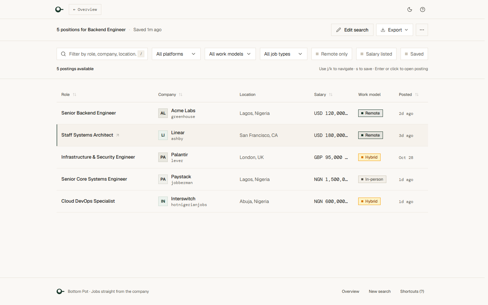
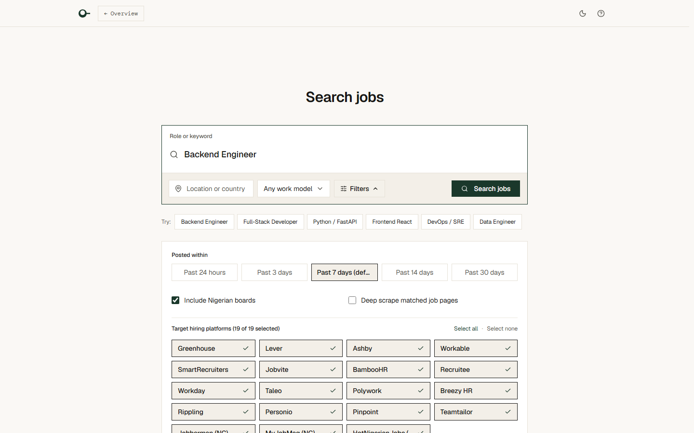
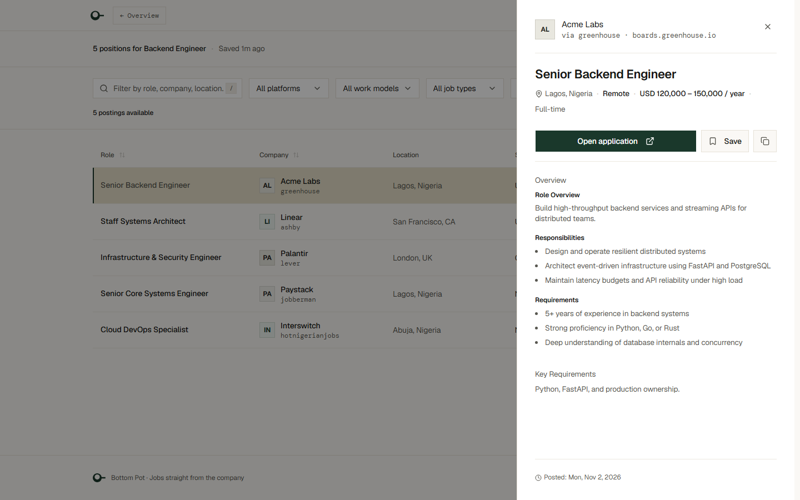
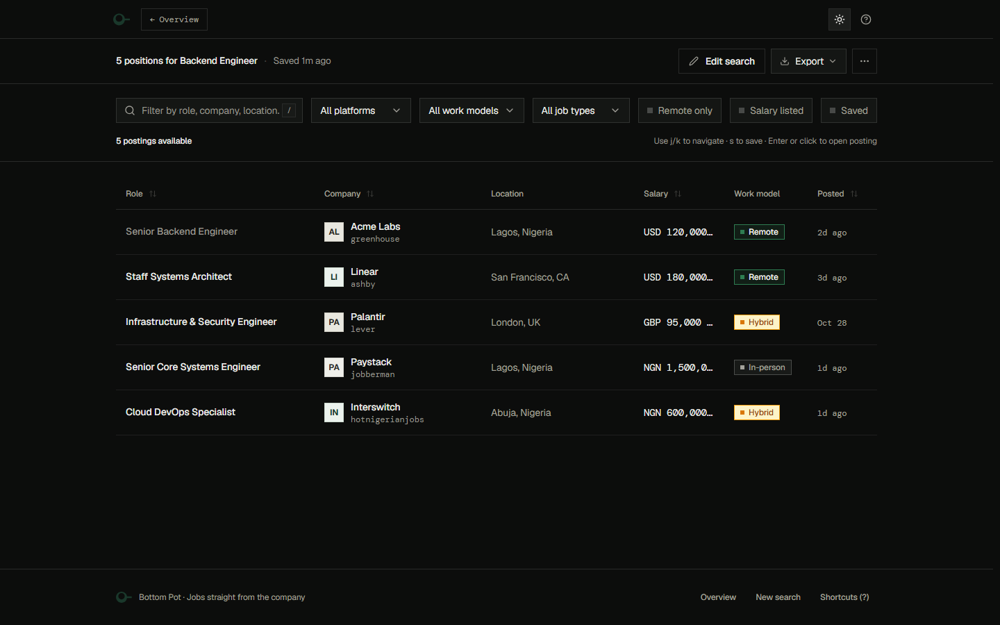

# Bottom Pot — Direct ATS Job Discovery Engine

Bottom Pot is an editorial, high-density search engine for software and tech roles, specializing in remote positions and opportunities relevant to Nigerian developers. Bottom Pot queries company Applicant Tracking Systems (ATS) and Nigerian job boards directly.



---

## What Bottom Pot Searches

Bottom Pot discovers postings directly at the source across three channels:

1. **18 Configured Global ATS Search Platforms** (defined in `ATS_PLATFORMS` in [`src/project_files/config.py`](src/project_files/config.py)): Greenhouse, Lever, Ashby, Workable, BambooHR, Jobvite, SmartRecruiters, iCIMS, Personio, Teamtailor, Recruitee, Breezy HR, Workday, Taleo, JobAdder, JazzHR, Avature, and SAP SuccessFactors. Discovery uses Serper.dev Google queries across these 18 platforms, while enrichment capabilities vary by provider (dedicated native JSON/board API clients exist for major providers such as Greenhouse, Lever, Ashby, Workable, SmartRecruiters, and Workday, alongside HTML/JSON-LD and DOM extraction pipelines).
2. **3 Nigerian Job Boards**: Jobberman (NG), MyJobMag (NG), and HotNigerianJobs (NG) via source-specific scrapers.
3. **Company Direct Board Routing**: When a search query includes recognized company slugs, Bottom Pot directly probes public career APIs for Greenhouse (`/v1/boards/{slug}/jobs`), Lever (`/v0/postings/{slug}?mode=json`), Ashby (`/posting-api/job-board/{slug}`), and Workable (`/api/v1/widget/accounts/{slug}` + `/api/v2/accounts/{slug}/jobs/{shortcode}`) concurrently with search and deduplicates results. 404s and non-200 responses are dropped without inventing data.

---

## Interface Showcase

| Search Workspace | Job Detail Sheet |
| :---: | :---: |
|  |  |

*Dark theme view:*


---

## How a Search Works

```
1. Discovery      → Serper Google dorks + direct ATS company board probes + Nigerian scrapers
2. URL Parsing    → ats_url_parser.py resolves platform, tenant slug, and canonical posting ID
3. Enrichment     → Concurrent fetchers retrieve job payloads via APIs and detail pages
4. Normalization  → Deterministic extraction of salary ranges, work model, and markdown descriptions
5. Deduplication  → Order-independent canonical identity deduplication
6. Streaming SSE  → Progressive real-time results streamed to browser over GET /search
```

### Caching Architecture
- **In-memory whole-search cache**: 300s for repeated identical queries.
- **Serper search queries cache**: 12h in SQLite (`data/cache.sqlite`).
- **Page enrichment cache**: 24h in SQLite (`data/cache.sqlite`).

---

## Core Principles

- **Unknown Beats Wrong**: Absence of evidence is never turned into an invented value ([ADR 0001](docs/adr/0001-unknown-beats-wrong.md)). Unstated work models remain `null`, and unlisted dates render as `"Date not listed"`.
- **Deterministic Extraction**: Deterministic extraction, no LLM in the extraction path.
- **Evidence Snippets**: Derived fields (such as work model) store a short excerpt of literal text alongside the source (`api`, `page_label`, `description`).
- **Backend Owns Parsing**: The backend normalizes titles, compensation, and snippets. The frontend never re-parses raw text.
- **Square Design System**: Strict `--radius: 0` geometry, warm editorial palette, restrained animations, and data-dense typography ([DESIGN.md](DESIGN.md)).

---

## Quickstart

### Prerequisites
- Python (see [pyproject.toml](pyproject.toml))
- Node.js & npm (see [frontend/package.json](frontend/package.json))
- Git

Verify local tooling with:
```powershell
.\scripts\bootstrap.ps1
.\scripts\check-env.ps1
```

### Installation & Run

1. **Configure Environment**:
   ```powershell
   Copy-Item .env.example .env
   ```

2. **Backend Setup**:
   ```powershell
   python -m venv venv
   .\venv\Scripts\activate
   pip install -r requirements.txt -r requirements-dev.txt
   python -m uvicorn src.api.main:app --reload
   ```
   FastAPI listens on `http://127.0.0.1:8000`.

3. **Frontend Development**:
   ```powershell
   cd frontend
   npm install
   npm run dev
   ```
   Vite dev server listens on `http://localhost:5173` (proxies `/search`, `/api/admin`, `/health`, `/subscribe` to `http://127.0.0.1:8000`).

   To serve the production UI directly via FastAPI:
   ```powershell
   npm --prefix frontend run build
   ```

### Key Environment Variables

Configure essential settings in `.env`:

- `SERPER_API_KEY`: API key for Serper.dev Google search API (required for live discovery).
- `SERPER_MODE`: Searcher mode (`live` for outbound queries, `cache_only` to replay from SQLite).
- `SERPER_DAILY_BUDGET`: Daily outbound Serper query limit before halting live queries (default `200`).
- `ADMIN_PASSWORD`: Plaintext password required to access `/admin` (leave blank to disable login).
- `ADMIN_SESSION_SECRET`: Secret key used to sign admin session cookies (auto-generated in memory if blank).
- `SQLITE_DB_PATH`: Filesystem path to SQLite cache database (default `data/cache.sqlite`).

*See [.env.example](.env.example) for timeout, rate limiting, and concurrency knobs.*

---

## Testing & Verification

Run the full verification suite:
```powershell
.\scripts\verify.ps1
```
*Note: Test counts grow over time as suites expand. Run `.\scripts\verify.ps1` for current pass counts and results.*

### Verification Checks
1. **Git Available**: Confirms git binary is present on PATH.
2. **Secrets Scan**: Scans tracked files against `.env`, keys, certificates, and credentials.
3. **CSS Cascade Lint**: Runs `node scripts/lint_css_cascade.js` to enforce `@layer` styling rules.
4. **Frontend Linting**: Runs `oxlint` across frontend code.
5. **Frontend Unit Tests**: Runs `vitest` across the frontend unit test suites.
6. **Frontend Build**: Runs `tsc -b && vite build` for production compilation.
7. **Python Unit Tests**: Runs `python -m pytest -q` across backend unit and integration test suites.
8. **Playwright E2E Suite**: Runs `npx playwright test` on Desktop Chromium (viewport audits internally cycle across 5 screen sizes: 1920×1080, 1440×900, 1024×768, 768×1024, 390×844).

*All automated tests execute offline against recorded fixtures, synthetic streams, and local mock servers without live network calls.*

---

## Project Structure

```
bottom-pot-v1/
├── docs/                    # Persistent documentation
│   ├── adr/                 # Architecture Decision Records
│   ├── agents/              # Agent operating guides & file structure
│   ├── design/              # UI screenshots (before, after, reference)
│   ├── steps/               # Sequential step execution logs
│   └── FRONTEND.md          # Frontend architecture guide
├── frontend/                # React / Vite single-page application
│   ├── src/                 # TypeScript source code & components
│   └── package.json         # Frontend dependencies & scripts
├── scripts/                 # PowerShell and Node automation scripts
│   ├── bootstrap.ps1        # Tooling inspection script
│   ├── check-env.ps1        # Environment health check script
│   └── verify.ps1           # Project verification runner (8 checks)
├── src/                     # Backend Python package
│   ├── api/                 # FastAPI endpoints (main.py)
│   ├── project_files/       # Scraper clients, normalizers, orchestrator, & ATS registry (config.py)
│   └── config.py            # Pydantic settings & runtime operational knobs
├── tests/                   # Automated test suites
│   ├── e2e/                 # Playwright end-to-end browser tests
│   ├── fixtures/            # Real ATS JSON and HTML response fixtures
│   └── test_*.py            # Pytest unit and integration suites
├── AGENTS.md                # Agent working agreement & repository instructions
├── BUILD_PROTOCOL.md        # 10-stage development methodology
├── CONTEXT.md               # Authoritative project domain & context
├── DESIGN.md                # Design philosophy, visual rules, & tokens
└── README.md                # Project documentation
```

Key reference documentation:
- [BUILD_PROTOCOL.md](BUILD_PROTOCOL.md) — 10-stage development methodology.
- [DESIGN.md](DESIGN.md) — Square design system and visual token specifications.
- [docs/adr/](docs/adr/) — Architectural decision records.
- [docs/steps/](docs/steps/) — Provenance logs for all completed development steps.
- [docs/FRONTEND.md](docs/FRONTEND.md) — Frontend architecture guide.

---

## Known Limitations

- **Google / Serper Discovery**: Google dorking via Serper can miss newly published postings or unindexed career pages.
- **Cache Freshness**: Results can be hours old due to query and enrichment caching.
- **Pay Periods**: Some salaries display without a pay period because the provider does not state one.
- **Unlisted Salaries**: Many employers publish postings without compensation figures.
- **Conflicting Compensation Tiers**: Postings with conflicting multi-tier salary ranges are left blank per ADR 0001.
- **MyJobMag Fixtures**: MyJobMag currently has no real-page HTML fixtures in the test suite (synthetic replay only).
- **Legacy Frontend**: `frontend-old/` remains in the tree as a deferred cleanup item.
