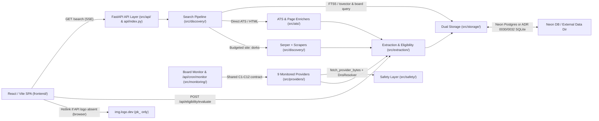

# Bottom Pot Architecture

Current-state module layout, data flows, safety boundaries, and frontend structure.

---

## 1. Backend Package Map (`src/`)

| Subpackage | Key Modules | Responsibility |
|---|---|---|
| `src/api/` & `api/index.py` | `main.py`, `allowlist.py`, `auth.py`, `api/index.py` | FastAPI app lifecycle, Vercel ASGI entrypoint, `GET /health`, SSE `GET /search` (`/api/search`), `POST /api/eligibility/evaluate`, `POST /subscribe`, `GET/POST /api/cron/monitor`, `/api/admin/login` HMAC cookies, and anonymous field redaction (`USER_*` vs `ADMIN_*`). |
| `src/core/` | `settings.py`, `data_dir.py`, `models.py`, `exceptions.py`, `clock.py`, `countries.py`, `http_headers.py`, `http_resilience.py`, `retry.py`, `observability.py` | Unified configuration (`Settings`, `ATS_PLATFORMS`), external `BOTTOM_POT_DATA_DIR` path resolution, Pydantic contracts (`JobListing`, `JobEligibility`, `DoneEvent`), fail-closed `SafetyError` hierarchy, ISO-2 country mapping, per-host circuit breakers/semaphores, and injectable `Clock`. |
| `src/safety/` | `db_safety.py`, `url_safety.py` | ADR 0030 & ADR 0032 multi-layer operational DB protection (`UnsafeDatabasePathError`, `OwnedDisposableWorkspace`, default-deny runtime grants) and SSRF URL/IP validation with injectable `DnsResolver` and per-hop redirect checks (`UnsafeRedirectError`). |
| `src/storage/` | `db_conn.py`, `sqlite_conn.py`, `cache_store.py`, `company_board_registry.py`, `subscriptions.py`, `db_backup.py` | Dual SQLite/Neon PostgreSQL connection pooling (`db_conn.py`, `managed_sqlite_connection`), Serper/URL cache + daily UTC budget store, monitored board & job registry (`FTS5` in SQLite, generated `tsvector` + GIN in Postgres), `subscriptions` store, and WAL/SHM-safe online `backup`/`check`/`rehearse` helpers. |
| `src/providers/` | `contract.py`, `http.py`, `fingerprint.py`, `pagination.py`, `detail_hydration.py`, `board_adapters.py`, and 9 per-provider modules (`greenhouse.py`, `lever.py`, `ashby.py`, `workable.py`, `recruitee.py`, `smartrecruiters.py`, `teamtailor.py`, `personio.py`, `pinpoint.py`) | Unified snapshot contract (`BoardCheckResult`, `FailureKind`, `ReconciliationPolicy`), noise-invariant 64-hex SHA-256 board fingerprinting, SSRF-safe `fetch_provider_bytes`, bounded detail hydration queues, and compatibility `BOARD_ADAPTERS` registry. |
| `src/monitoring/` | `board_monitor.py`, `employer_board_catalog.py`, `cache_repair/` (`engine.py`, `ashby.py`, `greenhouse.py`, `lever.py`, `workable.py`) | Lease-coordinated background polling daemon (`BoardMonitor`), 28-board curated catalog (`VERIFIED_EMPLOYER_BOARDS`), and dry-run-by-default cache repair strategies. |
| `src/ats/` | `ats_url_parser.py`, `ats_api_client.py`, `ats_page_enricher.py`, `direct_board_router.py` | ATS URL/slug recognition, direct public endpoint clients for discovery-hit postings, JSON-LD/HTML enrichment, and cached board auto-promotion helpers. |
| `src/discovery/` | `search_pipeline.py`, `serper_searcher.py`, `query_builder.py`, `nigerian_scrapers.py` | Two-phase SSE orchestration merging monitored SQLite jobs with budgeted Google `site:` dorks (Serper.dev) and 3 Nigerian job-board scrapers (`jobberman`, `myjobmag`, `hotnigerianjobs`), plus URL-level enrichment and conservative deduplication. |
| `src/extraction/` | `job_extraction_service.py`, `canonical_job_adapter.py`, `eligibility_extractor.py`, `eligibility_labels.py`, `freshness.py`, `domain_extractor.py`, `career_stage.py`, `work_model.py`, `salary_parser.py`, `field_normalizer.py`, `logo_extractor.py`, `relevance_classifier.py`, `deduplicator.py`, `confidence_policy.py`, `extraction_outcome.py`, `url_normalizer.py`, `html_helpers.py` | Deterministic structured-first extraction pipeline: field normalization, work arrangement ladder (`ADR 0002`), 4-dimension applicant eligibility (`ADR 0001` / `0003`), freshness tiers (`ADR 0034`), public-suffix verified `company_domain` extraction (`ADR 0031`), early-career detection, salary normalization (`ADR 0027`), and canonical identity deduplication. |

---

## 2. Frontend Map (`frontend/`)

- **UI shell & workspaces (`src/App.tsx`, `src/pages/*`, `src/components/Workspace.tsx`):** Dedicated public pages (`/`, `/product`, `/sources`, `/about`) plus candidate/admin workspaces (`/app`, `/admin`) enforcing the square `--radius: 0` visual system (`DESIGN.md`, `docs/FRONTEND.md`).
- **Search, filtering & detail views (`SearchForm.tsx`, `CompactSearchBar.tsx`, `Toolbar.tsx`, `ResultsTable.tsx`, `ResultsCards.tsx`, `DetailSheet.tsx`, `States.tsx`):** Responsive desktop table and 390px mobile stacked cards, country selector calling `POST /api/eligibility/evaluate` for instant re-evaluation, `"Older postings"` freshness divider, explicit notices (`budget_exhausted`/`incomplete`, zero results, search error), and optional `VITE_REPORT_PROBLEM_URL` issue links (`src/lib/reportLink.ts`).
- **Pure helper modules (`src/lib/`):** `apiBase.ts`, `router.ts`, `normalize.ts`, `eligibility.ts` + `legacyEligibilityFallback.ts`, `freshness.ts`, `sort.ts`, `filter.ts`, `logo.ts` (`api -> Logo.dev -> monogram`), `reportLink.ts`, `savedJobs.ts`, `visited.ts`, `urlState.ts`, `export.ts`, and `mock.ts`.

---

## 3. End-to-End Request & Data Flow

1. **Search (`/search` & `/api/search` SSE):** Streams monitored board postings first, fans out Serper/Nigerian queries under `SERPER_DAILY_BUDGET` and URL cache TTLs, enriches uncached ATS URLs through SSRF-checked `src/ats/`, runs `JobExtractionService` + freshness + `company_domain` resolution + conservative deduplication, evaluates against `applicant_country`, and redacts admin fields via `allowlist.py` for non-admin sessions.
2. **Board Monitoring (`BoardMonitor` & `/api/cron/monitor`):** Polls due `company_boards` rows across `BOARD_ADAPTERS` using `ReconciliationPolicy` confirmation thresholds (`1` vs `2`) and `detect_id_drift`, storing content fingerprints and timestamps cleanly in either Neon PostgreSQL (`managed_postgres_connection`) or local SQLite (`managed_sqlite_connection`).
3. **Storage & Isolation:** Cloud deployments set `DATABASE_URL` to Neon PostgreSQL; test contexts fail closed to disposable SQLite (`ADR 0030`/`0032`) unless `BOTTOM_POT_ALLOW_TEST_POSTGRES=1` is set explicitly. All test runners, Playwright E2E, and `scripts/smoke.py` never touch operational SQLite files.
