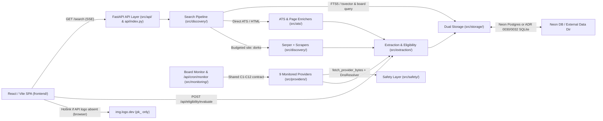

# Bottom Pot Architecture

Current-state module layout, data flows, safety boundaries, and frontend structure.

---

## 1. Backend Package Map (`src/`)

| Subpackage | Key Modules | Responsibility |
|---|---|---|
| `src/api/` & `api/index.py` | `main.py`, `allowlist.py`, `auth.py`, `api/index.py` | FastAPI app lifecycle, Vercel ASGI entrypoint, `GET /health`, SSE `GET /search` (`/api/search`), `POST /api/eligibility/evaluate`, `POST /subscribe`, `GET`/`POST /api/cron/monitor`, `/api/admin/login`, `/api/admin/logout`, `/api/admin/verify` HMAC cookies, and anonymous field redaction (`USER_*` vs `ADMIN_*`). |
| `src/core/` | `settings.py`, `data_dir.py`, `models.py`, `exceptions.py`, `clock.py`, `countries.py`, `http_headers.py`, `http_resilience.py`, `retry.py`, `observability.py` | Unified configuration (`Settings`, `ATS_PLATFORMS`), external `BOTTOM_POT_DATA_DIR` path resolution, Pydantic contracts (`JobListing`, `JobEligibility`, `DoneEvent`), fail-closed `SafetyError` hierarchy, ISO-2 country mapping, per-host circuit breakers/semaphores, and injectable `Clock`. |
| `src/safety/` | `db_safety.py`, `url_safety.py` | ADR 0030 & ADR 0032 multi-layer operational DB protection (`UnsafeDatabasePathError`, `OwnedDisposableWorkspace`, default-deny runtime grants) and SSRF URL/IP validation with injectable `DnsResolver` and per-hop redirect checks (`UnsafeRedirectError`). |
| `src/storage/` | `db_conn.py`, `sqlite_conn.py`, `cache_store.py`, `company_board_registry.py`, `registry_schema.py`, `subscriptions.py`, `db_backup.py` | Dual SQLite/Neon PostgreSQL connection pooling (`db_conn.py`, `managed_sqlite_connection`), Postgres DDL & monitored search planning (`registry_schema.py`), Serper/URL cache + daily UTC budget store, monitored board & job registry (`FTS5` in SQLite, generated `tsvector` + GIN in Postgres), `subscriptions` store, and WAL/SHM-safe online `backup`/`check`/`rehearse` helpers. |
| `src/providers/` | `contract.py`, `http.py`, `fingerprint.py`, `pagination.py`, `detail_hydration.py`, `board_adapters.py`, and 9 per-provider modules (`greenhouse.py`, `lever.py`, `ashby.py`, `workable.py`, `recruitee.py`, `smartrecruiters.py`, `teamtailor.py`, `personio.py`, `pinpoint.py`) | Unified snapshot contract (`BoardCheckResult`, `FailureKind`, `ReconciliationPolicy`), noise-invariant 64-hex SHA-256 board fingerprinting, SSRF-safe `fetch_provider_bytes`, bounded detail hydration queues, and compatibility `BOARD_ADAPTERS` registry. |
| `src/monitoring/` | `board_monitor.py`, `employer_board_catalog.py`, `cache_repair/` (`engine.py`, `ashby.py`, `greenhouse.py`, `lever.py`, `workable.py`) | Lease-coordinated background polling daemon (`BoardMonitor`), 28-board curated catalog (`VERIFIED_EMPLOYER_BOARDS`), and dry-run-by-default cache repair strategies. |
| `src/ats/` | `ats_url_parser.py`, `ats_api_client.py`, `ats_page_enricher.py`, `direct_board_router.py` | ATS URL/slug recognition, direct public endpoint clients for discovery-hit postings, JSON-LD/HTML enrichment, and cached board auto-promotion helpers. |
| `src/discovery/` | `search_pipeline.py`, `serper_searcher.py`, `query_builder.py`, `nigerian_scrapers.py` | Two-phase SSE orchestration merging monitored SQLite or Neon PostgreSQL jobs with direct company-board probing, 3 Nigerian job-board scrapers (`jobberman`, `myjobmag`, `hotnigerianjobs`), and conditional budgeted Google `site:` dorks (Serper.dev), plus URL-level enrichment and conservative deduplication. |
| `src/extraction/` | `job_extraction_service.py`, `canonical_job_adapter.py`, `eligibility_extractor.py`, `eligibility_labels.py`, `freshness.py`, `domain_extractor.py`, `career_stage.py`, `work_model.py`, `salary_parser.py`, `field_normalizer.py`, `logo_extractor.py`, `relevance_classifier.py`, `deduplicator.py`, `confidence_policy.py`, `extraction_outcome.py`, `url_normalizer.py`, `html_helpers.py` | Deterministic structured-first extraction pipeline: field normalization, work arrangement ladder (`ADR 0002`), 4-dimension applicant eligibility (`ADR 0001` / `0003`), freshness tiers (`ADR 0034`), public-suffix verified `company_domain` extraction (`ADR 0031`), early-career detection, salary normalization (`ADR 0027`), and canonical identity deduplication. |

---

## 2. Frontend Map (`frontend/`)

- **UI shell & workspaces (`frontend/src/App.tsx`, `frontend/src/pages/*`, `frontend/src/components/Workspace.tsx`):** Dedicated public pages (`/`, `/product`, `/sources`, `/about`) plus candidate/admin workspaces (`/app`, `/admin`) using the soft-square visual system (`4px`/`6px`/`8px` radius scale with square `0px` tables, hairlines, and edge-attached detail panel) owned by [`DESIGN.md`](../DESIGN.md) and [`frontend/src/index.css`](../frontend/src/index.css).
- **Search, filtering & detail views (`frontend/src/components/SearchForm.tsx`, `CompactSearchBar.tsx`, `Toolbar.tsx`, `ResultsTable.tsx`, `ResultsCards.tsx`, `DetailSheet.tsx`, `States.tsx`):** Responsive desktop fixed-layout table and flat hairline-separated 4-line mobile rows (`<768px`), country selector calling `POST /api/eligibility/evaluate` for instant re-evaluation, `"Older postings"` freshness divider, explicit notices (`budget_exhausted`/`incomplete`, zero results, search error), and optional `VITE_REPORT_PROBLEM_URL` issue links (`frontend/src/lib/reportLink.ts`).
- **Pure helper modules (`frontend/src/lib/`):** `apiBase.ts`, `adminAuth.ts`, `router.ts`, `constants.ts`, `countries.ts`, `identity.ts`, `normalize.ts`, `eligibility.ts`, `legacyEligibilityFallback.ts`, `freshness.ts`, `mobileCardMeta.ts`, `nigerianPlatforms.ts`, `platformMigration.ts`, `sort.ts`, `filter.ts`, `logo.ts` (`api -> Logo.dev -> monogram`), `reportLink.ts`, `savedJobs.ts`, `visited.ts`, `storage.ts`, `urlState.ts`, `export.ts`, `mock.ts`, `utils.ts`, and `viewTransition.ts`.

---

## 3. End-to-End Request & Data Flow

1. **Search (`/search` & `/api/search` SSE, `src/discovery/search_pipeline.py`):** Phase 1 starts monitored store lookup (`_search_monitored_store`), Nigerian board scrapers (`_search_nigerian_scraper`, when selected), and direct company-board probing (`_search_direct_boards`, when company slug candidates are extracted) concurrently via `asyncio.wait(..., FIRST_COMPLETED)`, streaming deduplicated batches as each completes. Phase 2 conditionally runs `_search_ats_serper` under `SERPER_DAILY_BUDGET` and URL cache TTLs when `SERPER_MODE="live"` (or `live_discovery=true`), or in `"fallback"` mode when Phase 1 yields fewer than `SERPER_FALLBACK_MIN_RESULTS` results. All search paths except `_search_direct_boards` apply `filter_and_rank_by_relevance`, followed by `JobExtractionService`, freshness tiering, `company_domain` resolution, conservative deduplication, `applicant_country` evaluation, and anonymous redaction (`src/api/allowlist.py`).
2. **Board Monitoring (`BoardMonitor` & `/api/cron/monitor`):** Polls due `company_boards` rows across `BOARD_ADAPTERS` using `ReconciliationPolicy` confirmation thresholds (`1` vs `2`) and `detect_id_drift`, storing content fingerprints and timestamps cleanly in either Neon PostgreSQL (`managed_postgres_connection`) or local SQLite (`managed_sqlite_connection`).
3. **Storage & Isolation:** Cloud deployments set `DATABASE_URL` (or fallback `POSTGRES_URL`) to Neon PostgreSQL; test contexts fail closed to disposable SQLite (`ADR 0030`/`0032`) unless `BOTTOM_POT_ALLOW_TEST_POSTGRES=1` is set explicitly. All test runners, Playwright E2E, and `scripts/smoke.py` never touch operational SQLite files.

---

## 4. Runtime Behavior

- **`GET /search` content negotiation (`src/api/main.py`, `vercel.json`, `frontend/vite.config.ts`):** When `Accept` prefers `text/html` without `text/event-stream`, `/search` returns the SPA `index.html` with `Vary: Accept`; `text/event-stream` requests (and `/api/search`) stream SSE events (`status`, `results`, `metrics`, `done`, `error`).
- **Gzip SSE bypass (`SafeGZipMiddleware`, `src/api/main.py`):** Compresses standard HTTP responses `>= 500` bytes while bypassing `/search`, `/api/search`, and `text/event-stream` responses so incremental SSE events flush immediately without buffering.
- **Direct-board probing (`_search_direct_boards`, `src/discovery/search_pipeline.py`, `src/ats/direct_board_router.py`):** Extracts candidate company slugs via `extract_company_slug_candidates`, probes up to 9 monitorable ATS providers, and registers non-empty boards. When non-empty `role_keywords` (query tokens longer than 2 characters not matching the probed slugs) are present, `_search_direct_boards` filters fetched postings by case-insensitive title substring match (`any(kw in job.title.lower() for kw in role_keywords)`); if no postings match that filter, it returns all unfiltered postings from the probed board (`listings = filtered if filtered else listings`). This path does not call `filter_and_rank_by_relevance` or check `RELEVANCE_MODE`.
- **Nigerian result caps in mixed searches (`src/discovery/search_pipeline.py`):** Whenever ATS search platforms are active alongside Nigerian scrapers, per-scraper results are capped at `min(12, max(5, max_results // 2))` and total Nigerian scraper results are capped at `min(25, int(max_results * 0.5))`.
- **Nigerian ATS query expansion (`src/discovery/query_builder.py`):** For searches targeting Nigeria, Lagos, Abuja, Port Harcourt, or Ibadan where `remote` is not explicitly `False`, ATS `site:` location clauses expand to `("Nigeria" OR "Lagos" OR "Remote" OR "EMEA")`.
- **Serper pagination cutoff (`src/discovery/search_pipeline.py`):** Pagination beyond the current page stops early unless the current page returns at least `8` organic results and at least `50%` parse as valid job URLs.
- **In-memory search cache & invalidation (`src/discovery/search_pipeline.py`, `src/core/settings.py`):** Process-local LRU cache (`CACHE_TTL_SECONDS`, `IN_MEMORY_CACHE_MAX_ENTRIES`) keyed on normalized search parameters, `RELEVANCE_MODE`, and the monitored store's `store_version` (monitored store writes bump `store_version` to invalidate stale entries).
- **Cron endpoint contract (`GET`/`POST /api/cron/monitor`, `src/api/main.py`, `vercel.json`, `.github/workflows/board-monitor.yml`):** Authenticates Bearer `CRON_SECRET` in constant time (`503` if unset, `401` if mismatched), acquires a `"board_monitor"` lease (`240s` TTL, returning `skipped: "lease_busy"` if held), bounds `max_boards` to `1..28` (default `10`), and defaults `seed` to `true` to idempotently seed `VERIFIED_EMPLOYER_BOARDS` via `seed_curated_boards()`.
- **Admin session authentication (`src/api/main.py`, `src/api/auth.py`):** `POST /api/admin/login`, `POST /api/admin/logout`, and `GET /api/admin/verify` manage an HMAC-SHA256 `HttpOnly` cookie (`ADMIN_COOKIE_NAME`, default `bp_admin_session`, 7-day TTL). Fails closed (`503`) when `ADMIN_PASSWORD` is unset, and generates an ephemeral process-local signing secret (logging an error) if `ADMIN_SESSION_SECRET` is omitted.
- **Postgres connection handling (`src/storage/db_conn.py`, `src/api/main.py`):** Resolves `DATABASE_URL` then `POSTGRES_URL` (suppressed in test contexts unless explicit or `BOTTOM_POT_ALLOW_TEST_POSTGRES=1`), maintains a `psycopg2.pool.ThreadedConnectionPool` (`1..10` connections) with a 30-second `SELECT 1` health check and `?` → `%s` translation; when `VERCEL` is set, background `BoardMonitor` startup is skipped and proxy client IP headers are honored.
